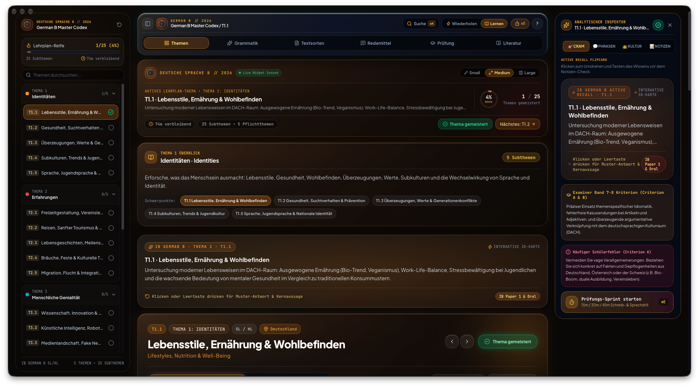
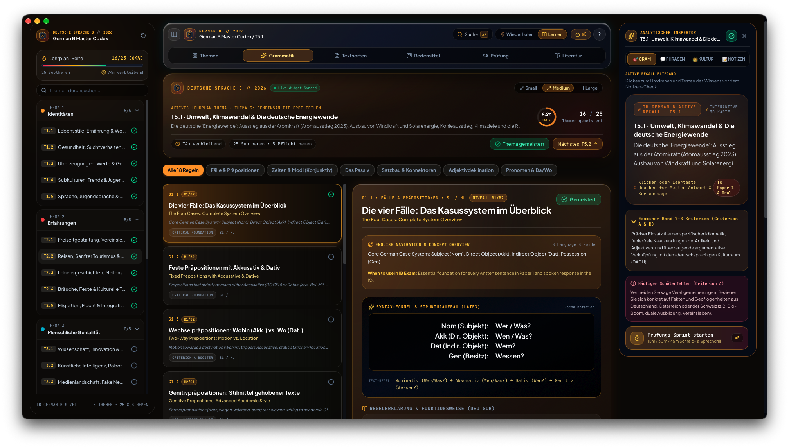
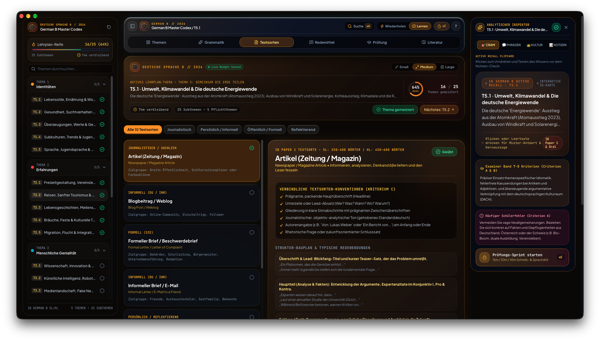
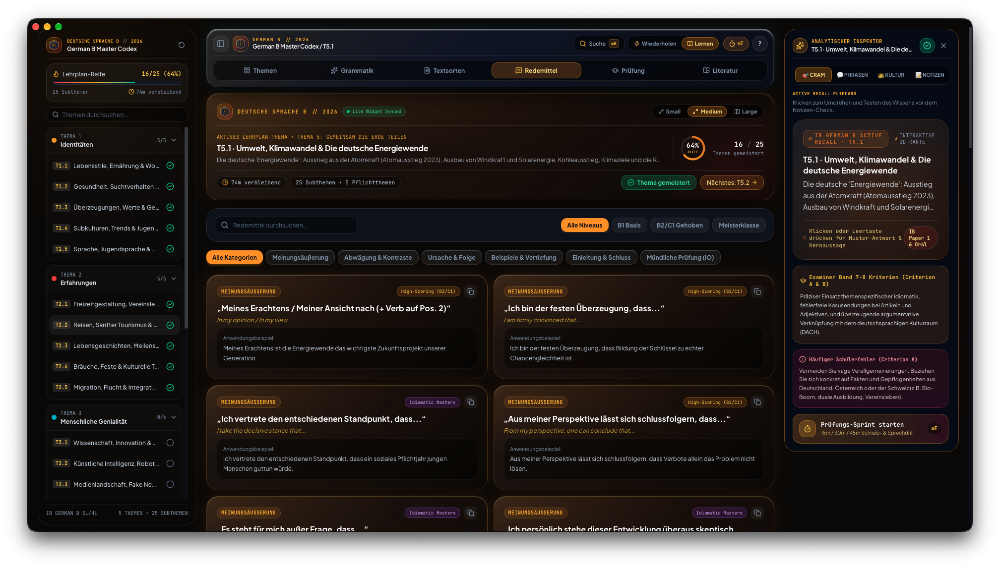
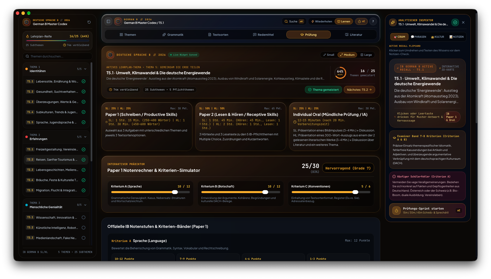

# 🇩🇪 German B Master Codex // IB German B SL & HL
### The IB German B Study Dashboard for macOS

**German B Master Codex** is a native macOS application built for International Baccalaureate (IB) Diploma Language B German students (Standard Level & Higher Level). It combines comprehensive 2020–2026 syllabus coverage across all 5 Prescribed Themes, 25 Subtopics, 18 core Grammar points with KaTeX LaTeX mathematical syntax notation, 10 official Paper 1 Textsorten writing formats, and a 120+ idiomatic Redemittel phrase vault with a warm amber & cognac Liquid Glass bento interface, active revision flipcards, and live desktop widgets.

---

## 📸 Interface Preview & Navigation

### 1. The Command Center (Hero Overview)

The primary launchpad provides a high-level view of your syllabus progress and current German study target:
* **Lehrplan-Reife Mastery Tracker**: Real-time progress monitoring across all 5 Prescribed Themes (*Identitäten*, *Erfahrungen*, *Menschliche Genialität*, *Soziale Organisation*, *Gemeinsam die Erde teilen*) and 25 subtopics, calculating remaining study time.
* **StudyMiniHomepage Capsule**: Live widget telemetry console with `• Live Widget Synced` indicator, multi-template size switcher (`Small`, `Medium`, `Large`), circular mastery gauge, and completion toggles.
* **Theme Context Overview Banner**: Strategic thematic context, cultural DACH anchors (Germany, Austria, Switzerland), and instant subtopic filter pills.
* **Analytical Pro Inspector**: 4-tab sidebar (`🎯 Cram`, `💬 Phrasen`, `👑 Kultur`, `📝 Notizen`) featuring interactive active recall flipcards, official Examiner Band 7–8 criteria (Criteria A & B), and common student pitfall alerts.
* **Global Spotlight Search**: Press `⌘K` to search across all themes, grammar rules, textsorten conventions, and oral phrases.

---

### 2. Grammar Lab & Syntax Formula Matrix

Designed to secure Band 7–8 in Criterion A (Language):
* **LaTeX Mathematical Syntax Formulas**: Formulated in KaTeX (`\begin{aligned} ... \end{aligned}`) for exact structural breakdown of cases, word order (ADUSO vs. Inversion), two-way prepositions (Akkusativ Wohin vs. Dativ Wo), Passive voice, and Konjunktiv II.
* **Bilingual Pedagogical Architecture**: Clear English explanations, exam usage rationale (*"When to use in IB Exam"*), and in-depth German rules (B1/B2/C1 CEFR benchmarks).
* **Cheat Tables & Pitfall Alerts**: Instant declension matrices (articles, adjective endings Typ 1/2/3) and frequent candidate errors.

---

### 3. Textsorten Vault (IB Paper 1 Writing Formats)

Comprehensive formatting rubrics for Paper 1 writing:
* **10 Prescribed Text Types**: Detailed blueprints for Artikel (Zeitung/Magazin), Blogbeitrag, Formeller Brief / Beschwerdebrief, Informeller Brief / E-Mail, Rede / Vortrag, Interview, Rezension / Filmkritik, Tagebucheintrag, Broschüre / Flyer, and Essay.
* **Criterion C Conventions**: Mandatory structural checklists (headlines, salutations, register Du/Ihr vs. Sie, sign-offs, call-to-action).
* **Word Count Targets**: Clear SL (250–400 words) and HL (450–600 words) guidelines with opening and closing formula banks.

---

### 4. Redemittel & Oral Exam Phrase Bank

Essential idiomatic connectors and debate phrases for Paper 1 and the Individual Oral (IO):
* **High-Scoring Connectors**: Categorized by communicative purpose: *Meinungsäußerung*, *Abwägung & Kontraste*, *Ursache & Folge*, *Beispiele & Vertiefung*, *Einleitung & Schluss*, and *Mündliche Prüfung (IO)*.
* **Band 7–8 Idiomatic Mastery**: High-impact idioms, modal particles (*ja, doch, mal, eben*), and sophisticated transition words with single-click clipboard copying.

---

### 5. Prüfungs-Sprint & Grade 7 Exam Simulator

Full assessment breakdown and interactive grading tools:
* **Interactive Paper 1 Score Predictor**: Real-time Grade 7 calculator modeling Criterion A (Language /12), Criterion B (Message /12), and Criterion C (Conceptual Understanding /6) with official mark boundaries.
* **Component Breakdown**: Visual guides for Paper 1 (Writing 25%), Paper 2 (Listening & Reading 50%), and Individual Oral (Internal Assessment 25%).
* **Timed Exam Sprint (`⌘E`)**: 15m, 30m, and 45m timed drills with randomized Paper 1 prompts, live word counter, and register guidance.

---

### 6. Desktop Widgets (macOS WidgetKit)
Keep revision top-of-mind without keeping the full app open:
* **Live Study Counter**: Displays active study streak, remaining syllabus subtopics, and current German study target on your desktop wallpaper or Notification Center.
* **Multi-Size Liquid Glass Templates**: Available in Small, Medium, and Large dossier view.
* **Local Offline Sync**: Synchronizes instantly across macOS without requiring an account login or cloud database.

---

## ⌨️ Keyboard Shortcuts

* `⌘ + K`: Open quick Spotlight search for themes, grammar points, and text types
* `⌘ + B`: Toggle sidebar navigation drawer
* `⌘ + I`: Toggle Pro Analytical Inspector
* `⌘ + E`: Launch Timed Exam Sprint simulation
* `1`: Switch to Prescribed Themes bento view
* `2`: Switch to Grammar Lab (`Grammatik`)
* `3`: Switch to Textsorten Vault (`Textsorten`)
* `4`: Switch to Redemittel Phrase Bank (`Redemittel`)
* `5`: Switch to Exam Simulator (`Prüfung`)
* `6`: Switch to Literature Works (`Literatur` - HL)
* `Space`: Flip active recall card in Inspector
* `?`: Open keyboard shortcuts cheat sheet

---

## 🛠️ Technical Highlights

* **Modern Web Core**: Built using Next.js 16, React 19, and Tailwind CSS.
* **Mathematical Notation**: High-performance KaTeX engine with zero horizontal overflow.
* **Native macOS Shell**: Runs inside an Apple AppKit and WKWebView container with smooth 120 FPS animations.
* **On-Device Storage**: Local state management persists notes, bookmarks, and progress directly on your Mac via Zustand.
* **Zero Dependencies**: Fully self-contained local build requiring no external cloud databases.

---

## 🎓 IB CAS Alignment

* **Creativity**: Engineering an elegant, native macOS study dashboard featuring an amber Liquid Glass visual identity, interactive KaTeX grammar matrices, and native desktop widgets.
* **Service**: Publishing open-source software to empower secondary school German language learners globally with accessible, distraction-free study resources.

---

## 🛠️ macOS Installation Instructions

Because this is a free, open-source app, macOS Gatekeeper may block it from opening initially because it hasn't been signed by a paid Apple Developer account. 

Here is how to safely install and open it:

1. Download the latest `IBGermanCodex-macOS-v1.0.1.dmg` file from the Releases page and double-click to open it.
2. Drag the **IB German B** app into your **Applications** folder.
3. Try to open the app by double-clicking it. You will see a warning that it cannot be opened. Click **Done** or **OK**.
4. Open your Mac's **System Settings** and navigate to **Privacy & Security**.
5. Scroll down to the **Security** section. You will see a message stating the app was blocked to protect your Mac.
6. Click the **Open Anyway** button next to that message.
7. Enter your Mac password or use Touch ID, then click **Open** on the final popup.
